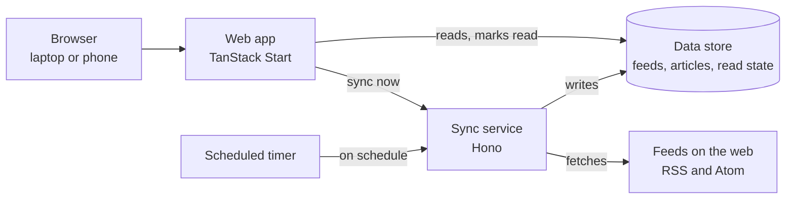

# Dusty: Project Spec

Nov 12, 2026 · @Gabe Shahbazian

Dusty is a personal, single-user RSS reader on Cloudflare: it syncs feeds by itself, and it makes triaging a long unread list fast and safe from the keyboard or a phone.

## Overview

**Why build it.** Hosted readers decide how triage works, how sync behaves and what they show about broken feeds. Owning the reader means the workflow (scan a list, mark everything above as read, move on) is built in, not added later.

**Goals**

- Triage a large unread backlog in minutes, mostly without a mouse.
- Work as well on a phone as on a laptop.
- Show plainly which subscriptions are dead, stale or failing, so the list stays clean.
- Deploy and run on Cloudflare with very little setup or upkeep.

**Non-goals (for now)**

- Multiple users, sharing or social features.
- Live or push updates to an open page. A manual refresh is enough (see Manual refresh).
- Native mobile apps. The responsive web app covers mobile.
- Alerts or notifications for failed syncs. Logs, metrics and the health view are enough for now.
- Starring or saving articles for later. The app syncs feeds and triages unread articles, nothing more.
- Exporting subscriptions to OPML. Import is in scope; export can come later.

## Platform and architecture

Two services on Cloudflare share one data store: a TanStack Start web app for reading, and a Hono sync service that fetches feeds.

Everything but the browser and the feeds runs on Cloudflare. The web app never fetches feeds itself; it only reads the store and asks the sync service to run.

| Decision | Why |
| --- | --- |
| Runs on Cloudflare | Cheap or free at one user's scale, nothing to patch, and timers and storage live on one platform. |
| Deployed with [Alchemy](https://alchemy.run/) | Infrastructure is TypeScript in the repo, so one command brings up every resource with very little manual setup in the dashboard. |
| TanStack Start for the web app | Type-safe routing plus server functions in one framework, so the UI and its data reads live together. |
| Hono for the sync service | A small, fast router built for Workers, which suits a service that mostly fetches, parses and writes. |
| Sync kept apart from the web app | Fetching many feeds is slow and fails often; keeping it separate means a bad feed never slows or breaks reading. |

**Requirements**

- A fresh deploy needs only the Alchemy config plus the secrets it asks for (such as the login credential).
- The web app and the sync service read and write the same store of feeds, articles and read state.
- The web app can ask the sync service to run now (see Feed syncing).

## Single-user auth

Only the owner can read or change anything; everyone else gets nothing back.

**Why.** The app is on the public internet. Reading history and subscriptions are personal, and the sync trigger could be abused to make the service fetch on demand. With one user, there is no need for sign-up, roles or account management.

**Requirements**

- Every page, server function and sync endpoint is behind auth, including the on-demand sync trigger.
- The scheduled sync runs without a login, but it cannot be started from outside.
- Login is rare: a session lasts a long time on a trusted device, so a phone does not ask every visit.
- No sign-up, password reset or user list. The one allowed identity (the owner's email) is set in config at deploy time.
- Logging out ends the session; revoking access ends every existing session.

**Method: Cloudflare Access, for now.** The app sits behind Cloudflare Access, with a policy that allows only the owner's email and a long login session.

**Why.** There is no login page, password storage or session handling to build, and requests without a valid login are stopped at Cloudflare's edge, before they reach the app.

- The app still verifies the identity Access passes with each request, so a request that bypasses Access is refused.
- Every address the app answers on is covered, including default and preview URLs.

**Swappable auth.** The app must not be tied to Cloudflare Access; replacing it later should be a small, contained change.

**Why.** Access is the quickest start, but the owner may later want a password, another login provider, or to run without Cloudflare's login. That choice should not ripple through the app.

- The rest of the app asks one place "who is this request from?" and gets back the owner or no one. Nothing else knows how login works.
- Switching methods changes only that one place and its config. Pages, server functions and the sync trigger stay as they are.
- Tests can stand in a fake login for Access, so the app is tested without it.

## Subscriptions

The owner keeps a list of the RSS and Atom feeds the app follows, and can add, rename and remove them.

**Why.** The subscription list decides what reaches the unread list. Adding has to be quick or good sources get skipped; removing has to be easy or dead feeds pile up.

**Requirements**

- Add a feed by pasting its URL. A site's home page URL should also work when the page advertises its feed.
- Adding checks the URL is a real feed, shows its title, and pulls its current articles right away.
- Adding a feed already in the list is refused, with a pointer to the existing one.
- Rename a feed's display title without touching the source.
- Remove a feed; its articles leave every unread list and count at once.
- The list shows each feed's unread count and its health (see Subscription health).
- Import subscriptions from an OPML file, so moving from the current reader takes one step instead of re-adding every feed by hand. Feeds already subscribed are skipped, and the import ends with a summary of what was added, skipped and failed. Articles already in imported feeds arrive as read, so an import does not flood the unread list.

## Feed syncing

The sync service fetches every feed on a timer, and again whenever the web app is loaded, so new articles are waiting without any manual step.

**Why on a timer.** Feeds drop old items. A feed checked only when the owner opens the app can lose articles between visits, and its health record would have gaps.

**Why on load.** The timer can be hours old when the owner sits down to read. A sync on load closes that gap at the moment it matters.

**Requirements**

- Scheduled sync runs every hour. The interval is set in config, so it can change without code changes.
- Loading the web app starts a sync in the background. The page shows what is stored at once; it never waits on the sync.
- An on-demand sync within 5 minutes of the last one is skipped (the window is set in config), so reloading the page does not hammer feeds.
- One slow or broken feed never blocks the others or stops the run.
- Each article is stored once. Re-fetching a feed never creates duplicates, and never marks a read article unread.
- An article edited at its source keeps its read state.
- Read articles are deleted 2 weeks after they were read (set in config); unread articles are never deleted. Old articles have no value to the owner, and pruning keeps the store small and lists fast. A deleted article still listed in its feed must never come back as unread on a later sync.
- Each fetch records its outcome and time, which feeds Subscription health.
- Be a polite client: send a clear user agent and use conditional requests, so unchanged feeds cost little.

**Observability**

**Why.** When a feed stops updating, the owner needs to know whether the feed, the network or the sync code is at fault, and since when. As subscriptions grow, syncs can slow down unnoticed. Subscription health answers "is this feed alive?"; logs, traces and metrics answer "why, and how is sync doing overall?"

- Structured logs for every sync run and every feed fetch: feed, trigger (scheduled, on load, refresh, new subscription), outcome, HTTP status, duration, articles found and new, and the full error on failure.
- OpenTelemetry tracing is first class, not an add-on: each sync run is one trace, with a span per feed and child spans for its fetch, parse and store steps. Spans carry the same details as the logs (feed, trigger, outcome, status, counts, error). An on-demand sync started by the web app continues the web app's trace. Every log line carries its trace and span ids, so a run can be followed end to end.
- Speed metrics: total duration of each run, and fetch duration per feed, so slow feeds stand out.
- Outcome metrics: successes and failures per run and per feed, broken down by error type (timeout, HTTP error, invalid feed).
- Health metrics over time: how many feeds are healthy, stale or failing.
- A skipped run (synced recently) or a run cut short (time limit) is logged with the reason.
- Logs, traces and metrics can be viewed with no setup beyond the deploy, and are kept long enough to compare this week with last.

## Subscription health

For every feed, the subscriptions view shows when it last published, when it last synced successfully, and whether it has been failing.

**Why.** A silent feed looks the same as a quiet one. Without these three facts the owner cannot tell an abandoned blog or a moved URL from a feed that simply posts rarely, so dead subscriptions linger.

| Shown per feed | Answers |
| --- | --- |
| Last article posted | Is this source still active? |
| Last successful sync | Is the app still reaching it? |
| Failing status | Is it broken right now, and for how long? |

**Requirements**

- Failing status shows how long it has failed (first failure time, or count of failures in a row) and the latest error in plain words, such as "404 not found" or "not a valid feed".
- A feed is flagged as failing once it has gone 2 days without a successful sync (set in config). Shorter outages are not flagged, so a brief outage does not cry wolf.
- A feed that has never synced successfully says so.
- The list can be sorted or filtered to put failing and stale feeds first, so cleanup takes one look.
- Remove a feed straight from this view.
- Times read as relative ("3 days ago") with the exact time on hover or tap.

## Unread lists

Unread articles can be read as one global list across all feeds, or as one list per feed.

**Why both.** The global list is the daily triage pass: everything new, in one place. The per-feed list is for catching up on a source the owner cares about, or for clearing a noisy one in a single sweep.

**Requirements**

- Both lists use the same row layout and the same actions, so habits carry over.
- Each row shows the title, feed name, publish time and a short excerpt.
- The global list is sorted oldest first, so a triage pass scrolls forward in time. Per-feed lists are sorted newest first, to see what a source posted lately. Both sort by publish time, with a fixed tiebreak so the order never shuffles between loads.
- Unread counts show globally and per feed, and agree with the lists.
- Open an article to read it in the app, with a way to open the original page.
- Opening an article marks it read; it can be marked unread again.
- Mark a single row read or unread without opening it.
- A read article stays where it is until the list is refreshed, so rows do not jump under the cursor.
- Long lists stay fast: thousands of unread articles must not slow scrolling or key presses.

## Mark all above as read

From any row, one action marks every row above it as read, leaving that row itself as it is, exactly as the list shows them on screen. This is a must-have.

**Why.** It is how the owner triages: scroll down, open what is interesting, and when the rest above is not worth reading, clear it in one action. It only works if it can be trusted without checking. Marking an article the owner never saw is silent data loss, because a read article drops out of the unread list for good.

**Requirements**

- It acts on exactly the rows on the owner's screen above the chosen row, in their on-screen order. Nothing else.
- Articles that arrived after the list was loaded are never touched, even if they would sort above the row. Syncs in the background must not change the result.
- It works the same in the global list and in per-feed lists, and respects any filter in view.
- Rows above that are already read stay read; nothing is marked unread.
- If any part fails, the owner is told; the screen never shows rows as read that the store did not save.
- An undo is offered right after, and it restores exactly the rows it changed.
- Available from the keyboard, the mouse and touch (see Keyboard shortcuts and Mobile).
- Covered by automated tests, including a sync landing between load and action.

## Manual refresh

A refresh button pulls the latest stored articles into the open page; the page never changes by itself.

**Why.** A list that updates on its own moves rows under the cursor and makes "mark all above" unsafe. Refreshing only when asked keeps the screen stable, and keeps the app simple by skipping live updates.

**Requirements**

- One button, plus a key (see Keyboard shortcuts), reloads the current list and all counts.
- Refresh also asks the sync service to run, subject to the same skip-if-recent rule as on load.
- While it runs, the button shows progress; afterwards it shows when data was last refreshed.
- After refresh, the cursor lands on a sensible row (the same article if it is still listed, else the top).

## Keyboard shortcuts (vim motions)

Every triage action can be done from the keyboard with vim-style keys, so a full pass needs no mouse.

**Why.** Triage is hundreds of small moves in a row. Reaching for the mouse each time is slow and breaks focus, and vim motions are already in the owner's hands.

**Proposed bindings** (to confirm while building)

| Keys | Action |
| --- | --- |
| `j` / `k` | Next / previous row |
| `5j`, `5k` | Move by a count |
| `gg` / `G` | First / last row |
| `Ctrl-d` / `Ctrl-u` | Half a page down / up |
| `o` or `Enter` | Open the article |
| `Esc` or `q` | Close the article, back to the list |
| `v` | Open the original page in a new tab |
| `m` | Toggle read on the current row |
| `A` | Mark all rows above the current one as read |
| `u` | Undo the last mark action |
| `r` | Refresh |
| `]` / `[` | Next / previous feed |
| `ga` / `gs` | Go to all unread / subscriptions |
| `?` | Show all shortcuts |

**Requirements**

- A visible cursor marks the current row, and the view scrolls to keep it on screen.
- `A` acts on the row the cursor is on, with the same guarantees as Mark all above as read.
- With an article open, `j` / `k` open the next or previous article in its place, so moving on never needs closing first; the arrow keys, Space and `Ctrl-d` / `Ctrl-u` scroll the text.
- Shortcuts are off while typing in a field, so adding a feed URL never fires an action.
- Multi-key sequences (`gg`, `ga`, counts) time out cleanly if not finished.
- The `?` overlay is the source of truth for what is bound.

## Mobile

On a phone the app is a first-class reader, not a shrunken desktop page: every feature works by touch, one-handed.

**Why.** A lot of reading happens away from the desk, in short bursts. If triage is awkward on a phone, the backlog grows until the next laptop session.

**Requirements**

- Layout adapts from phone to wide desktop; on a phone, list and article are separate screens with a clear way back.
- Tap targets are large enough to hit with a thumb, and primary actions sit within thumb reach.
- Mark all above as read is a deliberate touch action (for example, from a row's menu or a long press), hard to trigger by accident, with the same undo.
- Refresh is one tap on the Refresh button. No pull to refresh.
- Articles read well: comfortable type size, images fit the screen, no sideways scrolling.
- Fast on a phone network: the list appears quickly from stored data, not after a sync.
- Can be added to the home screen and opens full screen like an app.
- Respects the system light or dark setting.
